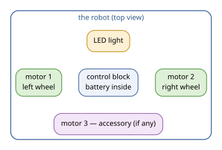
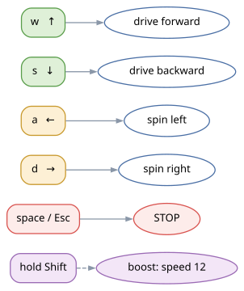
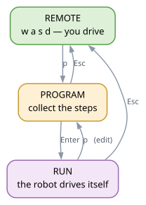

<div class="cover">
<p class="big">Apitor Remote</p>
<p class="sub">The big manual for young pilots</p>
<p class="who">robots Robot R · J · S · Q · X · Wheels</p>
<p class="who">for kids 6–15 and their grown-ups</p>

<p class="ver">source: docs/instructions-en.md · Russian version: instructions-ru.pdf</p>
</div>

# Table of contents

1. What the remote is
2. Meet the robot
3. The first connection
4. How to drive
5. The light
6. Three remote modes
7. Your first program
8. The “Square” program
9. The “Firefly” program
10. Challenges
11. Program files and the editor
12. The macro and the way back
13. If something is wrong
14. For grown-ups: install, flags, tuning
15. Mini dictionary
16. Cheat sheet

# 1. What the remote is

The “remote” is a program on your computer. It talks to the Apitor robot
over Bluetooth and tells it what to do. You press keys — the robot drives,
spins and blinks its light.

What you need:

* an **Apitor robot** — built and with a charged battery;
* a **computer with Bluetooth** — a laptop, or a desktop with a
  Bluetooth adapter;
* a **terminal window** where the remote is already running.

When everything is ready, you see something like this:

```
[info] Apitor remote — Robot R (product 'r')
[hint] q — connect · Shift+Q — disconnect · w/a/s/d — drive · …
```

The remote is not connected to the robot yet — that happens when you
press `q` (section 3). If there is no welcome line at all, ask a grown-up:
section 13.

What the remote cannot do: it does not drive the robot from far away
(stay within a few metres), it does not replace the official app, and it
cannot carry the robot up the stairs.

# 2. Meet the robot

{width=92%}

* **Motor 1 and motor 2** — the left and the right wheel. When the wheels
  spin in opposite directions, the robot turns on the spot.
* **Control block** — the robot’s “brain” and the battery. If the robot
  stays silent, the battery probably needs charging.
* **LED light** — a small lamp you can control from the keyboard
  (section 5).
* **Motor 3** — for extra mechanisms, if your model has them. Key `e`
  turns it forward, `Shift+E` turns it backward (it is a switch: press
  once to start, press again to stop).

The robot drives “relative to itself”: `w` goes wherever its nose points.
Turn the robot nose away from you and everything becomes obvious.

# 3. The first connection

1. Switch the robot on.
2. Put it on the floor — away from table edges, feet and pets.
3. Press `q`. The remote starts looking for the robot.
4. Wait a few seconds — you will see something like:

```
[robot] looking for the robot (powered on and not connected to a phone?)...
[robot] found Robot R (AA:BB:CC:DD:EE:FF), connecting...
[ok] connected: Robot R (AA:BB:CC:DD:EE:FF)
```

5. All set! The keys drive the robot now.

<div class="warn">
If the robot is connected to a phone, the computer cannot find it:
Bluetooth talks to one device at a time. Close the phone app and press
`q` again.
</div>

<div class="tip">
Next time `q` connects almost instantly: the robot’s address is
remembered. If the robot is switched off, the remote scans again and
tells you about it.
</div>

To disconnect, press `Shift+Q`. That is handy when the game is over: the
robot stops and stops waiting for commands.

# 4. How to drive

{width=58%}

| Keys | What they do |
|---|---|
| `w` or `↑` | forward |
| `s` or `↓` | backward |
| `a` or `←` | spin left on the spot |
| `d` or `→` | spin right on the spot |
| `space` or `Esc` | STOP — the robot freezes instantly |
| `]` `[` or `+` `-` | speed: 1 (very slow) … 12 (fast) |
| `Shift` (hold) | boost: speed 12 while held, the old speed comes back after |
| `k` or `l` | how to drive: “hold” or “latched” |

There are two ways to drive, switched with `k` and `l`:

* **hold**: the robot drives while the key is held down. Let go — it
  stops. This is the best way to learn and to park.
* **latched**: press `w` once and the robot drives until you press
  `space`. Great for long straights and one-step programs.

<div class="tip">
The `Shift` boost works only when the remote can watch real key presses
(on Linux that needs a permission, see section 13). If boost does not
come on, just drive at the usual speed. And remember: `Shift+Q`
disconnects the robot — that is not the boost.
</div>

<div class="mission">
**Challenge “Warm-up”.** Put the robot in the middle of the room. Drive
forward for two counts, stop, come back. Then spin a quarter turn
(`a` or `d`). Done? You are ready for section 7.
</div>

# 5. The light

{width=100%}

| Key | Colour | Key | Colour |
|---|---|---|---|
| `1` | red | `5` | cyan |
| `2` | orange | `6` | blue |
| `3` | yellow | `7` | purple |
| `4` | green | `8` | white |

* `0` — switch the light off entirely.
* `b` or `B` — blink: the LED flashes quickly in the current colour.
  The colour itself does not change.

<div class="mission">
**Game “Traffic light”.** One player is the traffic light: yellow, red,
green. The second player is the driver: stop on red, drive on green, get
ready on yellow. Then swap.
</div>

# 6. Three remote modes

{width=62%}

* **Remote** — the keys drive the robot (sections 4 and 5).
* **Program** — you collect the steps; the robot stands still and waits.
* **Run** — the robot performs the program by itself.

How to move around:

| Keys | Where you get |
|---|---|
| `p` or `P` | into the program mode — always, from anywhere |
| `Enter` | start the program (the run begins) |
| `Esc` | back to the remote (the program stays in memory) |
| `Enter` | drive the program (with `Shift` — without pauses) |
| `r` `t` | in the remote: drive the route back (section 12) |

A trick: if you press `p` while the robot is driving, the remote stops it
and opens the program. You can leave the program mode only with `Esc` —
pressing `p` inside the program does nothing. No accidental way out.

During a run: `space` pauses and resumes, `Esc` stops and returns to the
remote, `p` stops and goes straight to editing the program.

The LED shows the state: one green flash — start, two green flashes —
finish, red — the program was interrupted. After the finish the previous
colour comes back.

# 7. Your first program

A program is a list of steps: drive, turn, wait, blink, change the
colour. You collect them in the program mode (press `p`).

| Keys | A program step |
|---|---|
| `w` `s` `a` `d` (or arrows) | forward, backward, left, right |
| digits `1`…`9` `0` | how many times: `wwwww` = “forward 5”, `w5` as well, `0` means ten |
| `space` | pause |
| `b` | blink |
| `c` | next colour; `c` plus a digit picks an exact colour (`c3` — yellow) |
| `]` `[` | program speed (digits right after: `]12`) |
| `r` | repeat the whole program: `r` cycles 1→2→…, `r5` runs it 5 times |
| `Backspace` | delete the last step |
| `x` | clear the whole program |
| `Enter` | start it |
| `Esc` | back to the remote |

Under the prompt the remote shows your program as symbols:

```
[prog] ↑5 · →1 · ✦2 (3 steps · ~4.2 s · speed 6)
```

The same symbols are used in files and in these diagrams:

| Symbol | Step | Word |
|---|---|---|
| `↑` | forward | `forward` or `вперёд` |
| `↓` | backward | `back` or `назад` |
| `←` `→` | left, right | `left` `right` |
| `‖` | pause | `pause` or `пауза` |
| `✦` | blink | `blink` or `мигнуть` |
| `●` | colour | `color 3` or `цвет 3` |

The number next to a symbol is how many times the step repeats.

**How long it takes.** One “forward” step is about 0.6 seconds (the
number is multiplied by 0.6), a turn is the same, a pause is 1 second and
one blink is 0.25 seconds. The remote shows an estimate right away
(`~4.2 s`) and the real time after the run.

<div class="mission">
**Challenge “Knock-knock”.** Program: `forward 2`, `pause 1`,
`back 2`. What happened? What if the pause becomes a blink — can the
robot “knock” with light?
</div>

# 8. The “Square” program

{width=72%}

The square is the first real program. The robot drives forward, turns,
and repeats that four times — and you get a square. Collect it in the
program mode:

```
w4      forward 4
d2      spin right 2
b2      blink 2
r4      repeat everything four times
```

Press `Enter` — and away it goes. The very same program can be written
with words in a program file (section 11):

```
repeat 4
forward 4
right 2
blink 2
```

<div class="tip">
A quarter turn is about `d2`. If your square comes out lopsided, try
`d1` or `d3`: on different floors the robot turns a little differently.
That is normal — the robot does not know whether it is on carpet or
tiles.
</div>

<div class="mission">
**Challenge “Big square”.** Make a square twice as large: `forward 8`,
`right 2`, `repeat 4`. Guess how many seconds the run will take and check
yourself against the `[prog]` line.
</div>

# 9. The “Firefly” program

Now a dance with light: the robot spins while the LED changes colour.
Collect the program (or write it in a file and load it with `g`):

```
speed 4
repeat 4
blink 1
color 3
pause 1
color 6
pause 1
left 2
blink 2
```

What happens: the robot blinks yellow, waits, flashes blue, waits, spins
left and blinks once more — four times around. A little show.

<div class="tip">
A colour change is a step too: the robot changes the light not
immediately, but when it reaches that step. That is why a “dance” of
colours and pauses looks like a real light show.
</div>

# 10. Challenges

Stars show the difficulty: ★ — easy, ★★ — think a little, ★★★ — for
masters.

1. ★ **The straight line.** Drive from one edge of the carpet to the
   other and come back.
2. ★ **Traffic light.** Program: red, pause, green, blink, drive.
3. ★★ **The snake.** Forward, turn right, forward, turn left — three
   times.
4. ★★ **Two squares.** The square from section 8 with `repeat 2` — the
   robot must come back to where it started.
5. ★★ **The dance.** Spin, blink and change colours so that the
   grown-ups can guess the tune.
6. ★★★ **Boost race.** A long straight at speed 12 (the `Shift` boost) —
   without hitting the target.
7. ★★★ **The staircase.** Forward, right, forward, right… Build a path
   of steps to your toy. How many steps does it take?

Hints (open them only if you are really stuck):

* The snake: `w3 d1 w3 a1` — and repeat a few times.
* Two squares: put `repeat 2` at the very beginning of the program.
* The staircase: tune the turn number until you get a neat quarter turn
  (start with `d2`).
* The race: accelerate on the straight and press `space` before the
  target.

# 11. Program files and the editor

You can save a program into a file and load it next time.

| Keys | Action (in the program mode) |
|---|---|
| `f` | save: the remote asks for a name, `Enter` accepts it |
| `g` | load: a list of files, type a number and `Enter` |
| `e` (`E`) | edit the program in a full-size editor |
| `x` | clear the program |

Program files live in the `programs/` folder next to the remote. You can
open them in a text editor and write with words — in English or in
Russian:

```
# square: four sides and a blink at the end
speed 5
repeat 4
forward 4
right 2
blink 2
```

In a file you can use words (`forward`, `right`, `pause`, `blink`,
`color 3`, `repeat 4`, `speed 5`), the symbols (`↑5 · →2 · ✦2`) and
comments after `#`. The remote understands both English and Russian words
at once.

<div class="tip">
The program you collected will not be lost even if you close the remote:
it keeps a draft and picks it up next time. Ready-made examples live in
the `examples/` folder.
</div>

# 12. The macro and the way back

You do not have to collect a program by hand — you can **show** it: let
the remote record your trip. Such a recording is called a **macro**.

**How to record:**

1. Press `m` — the log shows `[rec] recording a macro`.
2. Drive the robot as usual: `w` `a` `s` `d`, the light, the turns, the
   pauses. The remote records everything, and every ride becomes a step
   with seconds.
3. Press `Esc` (or `n`) — the recording is ready and already sits in the
   program line. `m` only starts the recording: pressing it again just
   reminds you that the recording is on.

```
[rec] recording a macro: driving, light, speed are all recorded, pauses become waits; Esc or n — stop
[rec] ↑
[rec] ←
[rec] macro recorded: 3 steps · 2.88 s — Enter — drive, r/t — back, f — save, p — edit
```

Now `Enter` — and the robot repeats the trip by itself: with the same
pauses, light and speed. A macro is an ordinary program: you can edit it
(`p`), save it into a file (`f`) and load it next time (`g`).

<div class="warn">
While the recording is on, `p`, `Enter`, `r`, `t`, `x`, `f`, `g` do not
work: finish the recording first — `Esc` or `n`. And `space` is just a
robot stop: the recording continues.
</div>

## The way back: `r` and `t`

The robot drove away to the other end of the room. How to bring it back
along its own tracks without collecting a second program? There are two
keys for that:

* `r` — **backwards**. The robot drives the route from the end, and
  everything is mirrored: “forward” becomes “backward”, “left” becomes
  “right”. It backs along its own tracks.
* `t` — **the robot was turned by hand**. At the end of the route you
  turned it 180°, so it drives back forward: only the turns change
  (left ↔ right).

{width=100%}

The duration is kept: if the robot drove for 2 seconds on the way out,
it drives for 2 seconds on the way back as well (numbers like `↑5`
become seconds). The light, too: a stretch driven with the light-blue
colour is driven back with the same light-blue — the colour just
switches at another moment, when you reach that stretch (in the picture
`●5`, `●3`, `●1` stand in a different order).

<div class="tip">
`Shift+Enter` drives the program without pauses, and `R` or `T` (`Shift`
with `r` or `t`) does the same on the way back. The `Shift` variants
work only when the keyboard tracking is on (a grown-up knows what that
is: section 14).
</div>

The way back does not spoil the program: it is built on the fly, so
after it `Enter` drives forward again and `p` shows the old steps. And
`repeat` has nothing to do with it: back the robot always drives once —
after the first pass it already stands at the start of the route and
looks the other way.

# 13. If something is wrong

| What happened | What to do |
|---|---|
| `[err] could not connect` | is the robot on? not busy with a phone? press `q` again |
| The robot drives backward instead of forward | it is a setting: section 13, “calibration” |
| The robot is too slow or too fast | `]` and `[` change the speed (1…12) |
| The keys do nothing | the remote listens to the keyboard only while its window is active; press `h` for a hint. Do not type `w a s d` in other windows |
| `Enter` does not start the program | look at the `[prog]` line: `0 steps` means the program is empty |
| The robot stopped in the middle of a program | `space` was pressed (pause) — press it again |
| Everything is frozen | `Ctrl+C`: the remote stops the motors and quits |
| Not sure what to press | `h` — help; `Esc` — back to the remote |

# 14. For grown-ups: install, flags, tuning

**Install** (once):

```bash
cd Apitor-WASD
python3 -m venv .venv
.venv/bin/pip install -r requirements.txt
```

**Run:**

```bash
.venv/bin/python apitor_remote.py                # the usual remote
.venv/bin/python apitor_remote.py --tui          # full-screen interface:
                                                 # the banner on top shows the mode keys
.venv/bin/python apitor_remote.py --simulate     # no robot: print frames
.venv/bin/python apitor_remote.py --program examples/square.txt
```

On Linux the remote needs permission to read the keyboard (otherwise it
warns and falls back to auto-stop):
`sudo usermod -aG input "$USER"`, then log out and in again. On Windows
Python 3.10+ and Bluetooth are enough.

The `Shift` variants (`Shift+Enter`, `R`, `T` and the boost) work only
when the keyboard tracking is on. If you do not need it at all (the
auto-stop by `--hold-timeout` is enough), run with `--no-key-state`: the
remote will not read the keyboard in `/dev/input` and will not warn.

Useful flags (the full list is in the README):

| Flag | Why |
|---|---|
| `--speed 6` | starting speed 1…12 |
| `--latched` | start in the latched mode |
| `--program-dir DIR` | where program files live (default `programs/`) |
| `--step-time` `--turn-time` `--pause-time` `--blink-time` | step durations, s (0.6 / 0.6 / 1.0 / 0.25) |
| `--max-steps N` | limit the program length (0 — no limit) |
| `--log` | run journal in `~/.config/apitor-control/runs.log` |
| `--key-state-device PATH` | watch a single keyboard only |
| `--no-key-state` | do not read the keyboard at all: no permissions, no warnings |
| `--verbose` | detailed output: protocol frames and scanning |
| `--lang ru` | Russian interface |

**Calibration** (if the robot drives the wrong way). Connect and press
`y`: the robot drives forward, backward and sideways, so you can see what
is mixed up. Then start with the right flag:

```bash
.venv/bin/python apitor_remote.py --flip-left     # the left wheel spins the wrong way
.venv/bin/python apitor_remote.py --flip-right    # the right wheel
.venv/bin/python apitor_remote.py --left-motor 2 --right-motor 1   # the wheels are swapped
```

Key `i` runs the motors one by one — that shows which port drives which
wheel.

**This manual.** Sources: `docs/instructions-ru.md`,
`docs/instructions-en.md`; diagrams: `docs/diagrams/*.dot`. To rebuild
the pictures, the HTML and the PDFs:

```bash
docs/build.sh
```

It needs `pandoc`, `graphviz` and `calibre` (see `docs/README.md`).

# 15. Mini dictionary

* **Remote** — the program that drives the robot from your keyboard.
* **Macro** — a recording of your trip (`m`) that becomes a program.
* **The way back** — the robot drives the same route from the end (`r`, `t`).
* **Step** — one action of a program: drive, turn, blink.
* **Program** — a list of steps the robot performs by itself.
* **Run** — performing the program from start to finish.
* **Repeat** — how many times the whole program runs (`r` or `repeat`).
* **Hold** — the mode where the robot drives while you hold the key.
* **Latched** — the mode where the robot drives until you press `space`.
* **Boost** — speeding up to 12 while `Shift` is held.
* **Draft** — the program the remote remembers between launches.
* **Terminal** — the window where the remote lives; keys are pressed in it.

# 16. Cheat sheet

**Remote:**

| Keys | What they do |
|---|---|
| `q` / `Shift+Q` | connect / disconnect |
| `w` `s` `a` `d`, arrows | drive (forward, backward, left, right) |
| `space` `Esc` | STOP |
| `]` `[` `+` `-` | speed up / down |
| `Shift` | boost (while held) |
| `1`…`8`, `0` | light colour, `0` turns it off |
| `b` `B` | blink |
| `e` `Shift+E` | motor 3: forward / backward (a switch) |
| `k` `l` | hold / latched |
| `p` `P` | program mode |
| `Enter` | drive the program: the last macro or a file |
| `Shift+Enter` | the same, but without pauses |
| `r` `t` | drive the route back: backwards / turned around |
| `R` `T` | the same, but without pauses |
| `m` | record a macro (stop it with `Esc` or `n`) |
| `f` `g` | save / load a program file |
| `e` `E` | program editor |
| `y` `i` | test drive / motors one by one |
| `j` | run journal |
| `h` `?` | help |
| `Ctrl+C` | quit |

**Program mode:** `w/a/s/d` — steps · digits — how many times ·
`space` — pause · `b` — blink · `c` — colour · `r` — repeat ·
`]` `[` — speed · `Backspace` — delete a step · `x` — clear ·
`Enter` — start (with `Shift` — without pauses) · `Esc` — to the remote.
**The way back:** `R` — backwards, without pauses, `t` `T` — forward
(the small `r` in the editor is the repeat; with pauses — `r` in the remote).

**Run:** `space` — pause/resume · `Esc` — stop · `p` — edit.
After a run: `Enter` — once more, `r` `t` — back.

A mini example (the square) as a file `programs/square.txt`:

```
speed 5
repeat 4
forward 4
right 2
blink 2
```

<div class="tip">
More programs and examples are in the `examples/` folder. A pilot who
has made it this far: build your own track, put down a bottle as a
target and try to drive around it without touching it. Good luck!
</div>
