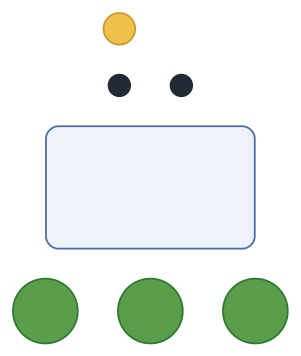
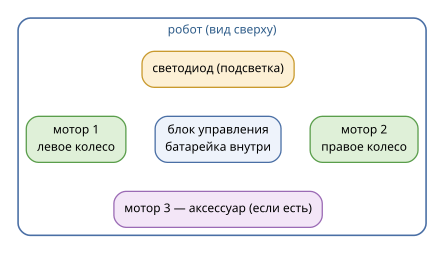
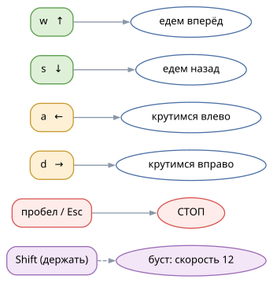
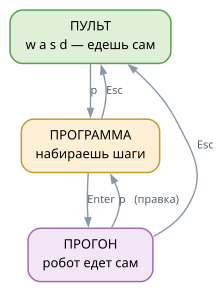
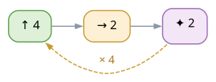
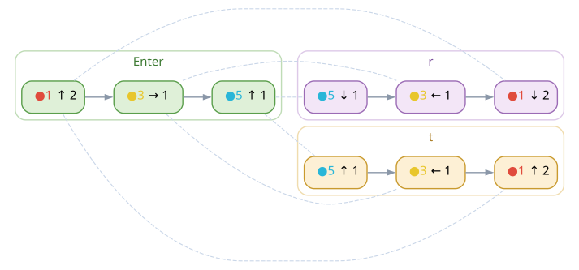

<div class="cover">
<p class="big">Пульт Apitor</p>
<p class="sub">Большая инструкция для юных пилотов</p>
<p class="who">роботы Robot R · J · S · Q · X · Wheels</p>
<p class="who">для детей 6–15 лет и их взрослых</p>

<p class="ver">исходник: docs/instructions-ru.md · английская версия: instructions-en.pdf</p>
</div>

# Содержание

1. Что такое пульт — {{page:1}}
2. Знакомство с роботом — {{page:2}}
3. Первое подключение — {{page:3}}
4. Как ехать — {{page:4}}
5. Подсветка — {{page:5}}
6. Три режима пульта — {{page:6}}
7. Первая программа — {{page:7}}
8. Программа «Квадрат» — {{page:8}}
9. Программа «Светлячок» — {{page:9}}
10. Испытания — {{page:10}}
11. Файлы программ и редактор — {{page:11}}
12. Макрос и обратный проезд — {{page:12}}
13. Если что-то не так — {{page:13}}
14. Взрослым: установка, флаги, подстройка — {{page:14}}
15. Словарик — {{page:15}}
16. Шпаргалка — {{page:16}}

# 1. Что такое пульт

«Пульт» — это программа на компьютере. Она по Bluetooth говорит роботу
Apitor, что делать. Ты нажимаешь клавиши — робот едет, крутится
и мигает светом.

Что понадобится:

* **робот Apitor** — собранный, с заряженной батарейкой;
* **компьютер с Bluetooth** — ноутбук или настольный с Bluetooth-адаптером;
* **окно терминала**, в котором уже запущен пульт.

Когда всё готово, в окне видно примерно такое:

```
[info] пульт Apitor — Robot R (product 'r')
[hint] q — подключиться · Shift+Q — отключиться · w/a/s/d — ехать · …
```

Пульт ещё не подключён к роботу — это делается клавишей `q`
(раздел 3, стр. {{page:3}}).
Если строки с приглашением нет совсем, позови взрослого:
раздел 14, стр. {{page:14}}.

Чего пульт не умеет: он не управляет роботом издалека (нужны те же
несколько метров), не заменяет официальное приложение и не поднимает
робота по лестнице.

# 2. Знакомство с роботом

{width=92%}

* **Мотор 1 и мотор 2** — левое и правое колесо. Если колёса крутятся
  в разные стороны, робот разворачивается на месте.
* **Блок управления** — «мозг» робота и батарейка. Если робот молчит,
  скорее всего, батарейку пора зарядить.
* **Светодиод** — маленькая лампочка. Ей можно управлять с клавиатуры
  (раздел 5, стр. {{page:5}}).
* **Мотор 3** — для дополнительных механизмов, если они есть у твоей
  модели. Клавиша `v` включает его вперёд, `V` — назад (это
  выключатель: нажал — включился, нажал ещё раз — выключился).

Робот ездит «относительно себя»: куда смотрит его нос, туда и `w`.
Поставь робота носом от себя — и всё станет понятно.

# 3. Первое подключение

1. Включи робота.
2. Поставь его на пол — подальше от края стола, ног и хвостов.
3. Нажми `q`. Пульт начнёт искать робота.
4. Подожди несколько секунд — появится что-то такое:

```
[robot] ищу робота (включён и не занят телефоном?)...
[robot] нашёл Robot R (AA:BB:CC:DD:EE:FF), подключаюсь...
[ok] подключено: Robot R (AA:BB:CC:DD:EE:FF)
```

5. Готово! Теперь клавиши управляют роботом.

<div class="warn">
Если робот подключён к телефону, компьютер его не найдёт: Bluetooth
разговаривает только с одним устройством за раз. Закрой приложение
на телефоне и нажми `q` снова.
</div>

<div class="tip">
В следующий раз `q` подключится почти сразу: адрес робота запоминается.
Если робот выключен, пульт поищет заново и скажет об этом.
</div>

Отключиться — `Shift+Q`. Это удобно, когда игра закончена: робот
остановится и перестанет ждать команд.

# 4. Как ехать

{width=58%}

| Клавиши | Что делает |
|---|---|
| `w` или `↑` | вперёд |
| `s` или `↓` | назад |
| `a` или `←` | развернуться влево на месте |
| `d` или `→` | развернуться вправо на месте |
| `пробел` или `Esc` | СТОП — робот замирает мгновенно |
| `]` `[` или `+` `-` | скорость: 1 (очень медленно) … 12 (быстро) |
| `Shift` (держать) | буст: скорость 12, а после отпускания — прежняя |
| `k` или `l` | как ехать: «удержание» или «фиксация» |

Как ехать — два способа, переключаются клавишами `k` и `l`:

* **удержание**: робот едет, пока клавиша нажата. Отпустил —
  остановился. Так удобнее всего учиться и парковаться.
* **фиксация**: нажал `w` — робот поехал и едет, пока не нажмёшь
  `пробел`. Удобно для длинных прямых и для программ из одного шага.

<div class="tip">
Буст по `Shift` работает, только когда пульт «видит» нажатия клавиш
(на Linux это требует разрешения, см. раздел 14, стр. {{page:14}}). Если буст
не включается — просто езжай на обычной скорости. И помни: `Shift+Q` —
это отключение робота, а не буст.
</div>

<div class="mission">
**Испытание «Разминка».** Поставь робота в центр комнаты. Проедь
вперёд два счёта, остановись, вернись назад. Потом развернись на
четверть круга (`a` или `d`). Получилось — ты готов к разделу 7,
стр. {{page:7}}.
</div>

# 5. Подсветка

{width=100%}

| Клавиша | Цвет | Клавиша | Цвет |
|---|---|---|---|
| `1` | красный | `5` | голубой |
| `2` | оранжевый | `6` | синий |
| `3` | жёлтый | `7` | фиолетовый |
| `4` | зелёный | `8` | белый |

* `0` — выключить подсветку совсем.
* `b` или `B` — мигнуть: светодиод быстро вспыхивает текущим цветом.
  Цвет при этом не меняется.

<div class="mission">
**Игра «Светофор».** Один игрок — светофор: жёлтый, красный, зелёный.
Второй — водитель: на красный стоит, на зелёный едет, на жёлтый
готовится. Потом поменяйтесь.
</div>

# 6. Три режима пульта

{width=62%}

* **Пульт** — клавиши ведут робота (разделы 4 и 5, стр. {{page:4}}
  и {{page:5}}).
* **Программа** — ты набираешь шаги; робот стоит и ждёт.
* **Прогон** — робот выполняет программу сам.

Как переходить:

| Клавиши | Куда попадаешь |
|---|---|
| `p` или `P` | в режим программы — всегда и откуда угодно |
| `Enter` | запустить программу (начался прогон) |
| `Esc` | назад в пульт (программа остаётся в памяти) |
| `Enter` | выполнить программу (с `Shift` — без пауз) |
| `r` `t` | в пульте: проехать маршрут обратно (раздел 12, стр. {{page:12}}) |

Хитрость: если нажать `p`, когда робот едет, пульт остановит его
и откроет программу. А выйти из программы можно только через `Esc` —
нажатие `p` внутри программы ничего не делает. Случайно не выскочишь.

Во время прогона: `пробел` — пауза и продолжить, `Esc` — остановить
и вернуться в пульт, `p` — остановить и сразу перейти к правке программы.

Светодиод подсказывает состояние: зелёная вспышка — старт, две зелёные —
финиш, красная — программу прервали. После финиша возвращается цвет,
который был раньше.

# 7. Первая программа

Программа — это список шагов: поехать, повернуть, подождать, мигнуть,
поменять цвет. Набирается в режиме программы (клавиша `p`).

| Клавиши | Шаг программы |
|---|---|
| `w` `s` `a` `d` (или стрелки) | вперёд, назад, влево, вправо |
| цифры `1`…`9` `0` | сколько раз: `wwwww` = «вперёд 5», `w5` — тоже, `0` — десять |
| `пробел` | пауза |
| `b` | мигнуть |
| `c` | цвет по кругу; `c` и сразу цифра — точный цвет (`c3` — жёлтый) |
| `]` `[` | скорость программы (цифры сразу: `]12`) |
| `r` | повтор всей программы: `r` — по кругу 1→2→…, `r5` — ровно 5 раз |
| `Backspace` | убрать последний шаг |
| `x` | очистить программу целиком |
| `Enter` | запустить |
| `Esc` | вернуться в пульт |

Под окном пульт показывает программу значками:

```
[prog] ↑5 · →1 · ✦2 (3 шага · ~4.2 с · скор. 6)
```

Значки те же, что в файлах и на схемах:

| Значок | Шаг | Слово |
|---|---|---|
| `↑` | вперёд | `вперёд` или `forward` |
| `↓` | назад | `назад` или `back` |
| `←` `→` | влево, вправо | `влево` `вправо` или `left` `right` |
| `‖` | пауза | `пауза` или `pause` |
| `✦` | мигнуть | `мигнуть` или `blink` |
| `●` | цвет | `цвет 3` или `color 3` |

Число рядом со значком — сколько раз повторить шаг.

**Сколько это длится.** Один шаг «вперёд» — примерно 0,6 секунды
(число умножается на 0,6), поворот — столько же, пауза — 1 секунду,
одно мигание — 0,25 секунды. Пульт сразу показывает оценку `~4.2 с`,
а после прогона — сколько вышло на самом деле.

<div class="mission">
**Испытание «Тук-тук».** Программа: `вперёд 2`, `пауза 1`, `назад 2`.
Что получилось? А если паузу заменить миганием — робот успеет
«постучать» светом?
</div>

# 8. Программа «Квадрат»

{width=72%}

Квадрат — первая настоящая программа. Робот едет вперёд, поворачивает,
и так четыре раза — получается квадрат. Набери в режиме программы:

```
w4      вперёд 4
d2      повернуть вправо 2
b2      мигнуть 2
r4      повторить всё четыре раза
```

Нажми `Enter` — и робот поехал. То же самое можно записать словами
в файле программы (раздел 11, стр. {{page:11}}):

```
повтор 4
вперёд 4
вправо 2
мигнуть 2
```

<div class="tip">
Поворот на четверть круга — примерно `d2`. Если квадрат получился
кособокий, попробуй `d1` или `d3`: на разных покрытиях робот
поворачивается чуть по-разному. Это нормально — робот не зря
катается по ковру и по плитке.
</div>

<div class="mission">
**Испытание «Большой квадрат».** Сделай квадрат в два раза больше:
`вперёд 8`, `вправо 2`, `повтор 4`. Прикинь, сколько секунд будет
длиться прогон, и проверь себя по строке `[prog]`.
</div>

# 9. Программа «Светлячок»

Теперь танец со светом: робот крутится, а подсветка меняет цвет.
Набери программу (или напиши в файле и загрузи клавишей `g`):

```
скорость 4
повтор 4
мигнуть 1
цвет 3
пауза 1
цвет 6
пауза 1
влево 2
мигнуть 2
```

Что происходит: робот мигает жёлтым, ждёт, вспыхивает синим, ждёт,
разворачивается влево и мигает ещё раз — и так четыре круга.
Получается маленький спектакль.

<div class="tip">
Цвет — это тоже шаг: робот меняет подсветку не сразу, а когда
до этого шага доедет. Поэтому «танец» из цветов и пауз выглядит
как настоящий светомузыкальный номер.
</div>

# 10. Испытания

Задания со звёздочками: ★ — просто, ★★ — надо подумать,
★★★ — для мастеров.

1. ★ **Прямая.** Проедь от одного края ковра до другого и вернись.
2. ★ **Светофор.** Программа: красный, пауза, зелёный, мигнуть,
   поехать.
3. ★★ **Змейка.** Вперёд, поворот вправо, вперёд, поворот влево —
   и так три раза.
4. ★★ **Два квадрата.** Квадрат из раздела 8 (стр. {{page:8}}) с `повтор 2` — робот
   должен вернуться туда, откуда начал.
5. ★★ **Танец.** Крутиться, мигать и менять цвет так, чтобы взрослые
   угадали мелодию.
6. ★★★ **Гонка с бустом.** Длинная прямая на скорости 12 (буст
   `Shift`) — и не задеть мишень.
7. ★★★ **Лестница.** Вперёд, вправо, вперёд, вправо… Сделай из
   ступенек путь к игрушке. Сколько шагов до неё?

Подсказки (открывай, только если совсем застрял):

* Змейка: `w3 d1 w3 a1` — и повторить несколько раз.
* Два квадрата: поставь `повтор 2` в самом начале программы.
* Лестница: подбери число поворота так, чтобы получалась ровная
  четверть круга (начни с `d2`).
* Гонка: разгон лучше делать на прямой, а перед мишенью жать `пробел`.

# 11. Файлы программ и редактор

Программу можно сохранить в файл — и загрузить в следующий раз.

| Клавиши | Действие (в режиме программы) |
|---|---|
| `f` | сохранить: пульт спросит имя, `Enter` — согласиться |
| `g` | загрузить: список файлов, набери номер и `Enter` |
| `e` (`E`) | править программу в большом редакторе (можно и из пульта) |
| `x` | очистить программу |

Файлы программ лежат в папке `programs/` рядом с пультом. Их можно
открыть блокнотом и писать словами — по-русски или по-английски:

```
# квадрат: четыре стороны и мигнуть в конце
скорость 5
повтор 4
вперёд 4
вправо 2
мигнуть 2
```

В файле можно писать словами (`вперёд`, `вправо`, `пауза`, `мигнуть`,
`цвет 3`, `повтор 4`, `скорость 5`), значками (`↑5 · →2 · ✦2`)
и добавлять комментарии после `#`. Пульт понимает и русские,
и английские слова сразу.

<div class="tip">
Набранная программа не пропадёт, даже если закрыть пульт: он хранит
черновик и подхватывает его в следующий раз. А готовые примеры лежат
в папке `examples/`.
</div>

# 12. Макрос и обратный проезд

Программу можно не набирать руками, а **показать**: пусть пульт сам
запишет поездку. Такая запись называется **макрос**.

**Как записать:**

1. Нажми `m` — в логе появится `[rec] запись макроса`.
2. Управляй роботом как обычно: `w` `a` `s` `d`, свет, повороты,
   паузы. Пульт записывает всё, и каждая поездка становится шагом
   с секундами.
3. Нажми `Esc` (или `n`) — запись готова и уже стоит в строке программы.
   `m` только начинает запись: если нажать её ещё раз, пульт просто
   напомнит, что запись идёт.

```
[rec] запись макроса: езда, свет, скорость — всё запишется, паузы станут ожиданием; Esc или n — стоп
[rec] ↑
[rec] ←
[rec] макрос записан: 3 шага · 2.88 с — Enter — проехать, r/t — обратно, f — сохранить, p — править
```

Теперь `Enter` — и робот сам повторит поездку: с паузами, светом
и скоростью, как было. Макрос — обычная программа: его можно править
(`p`), сохранить файлом (`f`) и загрузить в следующий раз (`g`).

<div class="warn">
Пока идёт запись, `p`, `Enter`, `r`, `t`, `x`, `f`, `g` не работают:
сначала закончи запись — `Esc` или `n`. А `пробел` — просто стоп робота,
запись при этом продолжается.
</div>

## Обратный проезд: `r` и `t`

Робот уехал в другой конец комнаты. Как вернуть его по своим следам,
не собирая вторую программу? Для этого есть две клавиши:

* `r` — **задним ходом**. Робот проезжает маршрут с конца, и всё
  зеркально: «вперёд» становится «назад», «влево» — «вправо».
  Он пятится по своим следам.
* `t` — **робота развернули рукой**. В конце маршрута ты повернул его
  на 180°, и он едет обратно передом: меняются только повороты
  (влево ↔ вправо).

{width=100%}

Длительность сохраняется: если туда робот ехал 2 секунды, обратно он
тоже поедет 2 секунды (числа вроде `↑5` превращаются в секунды).
Свет — тоже: участок, который проехали с голубым, обратно проезжается
с голубым, только цвет включается в другой момент, когда до этого
участка доедешь (на схеме видно: `●5` `●3` `●1` встали по-другому).

<div class="tip">
`Shift+Enter` — проехать программу без пауз, а `R` или `T` (`Shift`
вместе с `r` или `t`) — так же обратно, без пауз. Заглавная буква
приходит сама, а `Shift+Enter` пульт узнаёт от самого терминала
(kitty, foot, alacritty и другие) — или от слежения за клавишами,
если оно включено (взрослый знает, что это: раздел 14, стр. {{page:14}}).
</div>

Обратный проезд не портит программу: он строится на лету, поэтому
после него `Enter` снова везёт вперёд, а `p` показывает прежние шаги.
И `повтор` тут ни при чём: обратно робот всегда едет один раз — после
первого проезда он уже стоит в начале маршрута и смотрит в другую
сторону.

# 13. Если что-то не так

| Что случилось | Что делать |
|---|---|
| `[err] подключиться не удалось` | робот включён? не занят телефоном? нажми `q` ещё раз |
| Робот едет назад вместо вперёд | это чинится настройкой: раздел 14 (стр. {{page:14}}), «калибровка» |
| Робот едет слишком медленно или быстро | `]` и `[` меняют скорость (1…12) |
| Клавиши не действуют | пульт слушает клавиатуру только когда его окно активно? Нажми `h` — увидишь подсказку. В других окнах не печатай `w a s d` |
| `Enter` не запускает программу | посмотри на строку `[prog]`: если там `0 шагов`, программа пустая |
| Робот остановился посреди программы | нажался `пробел` (пауза) — нажми ещё раз |
| Всё зависло | `Ctrl+C`: пульт остановит моторы и выйдет |
| Не понятно, что нажимать | `h` — справка; `Esc` — назад в пульт |

# 14. Взрослым: установка, флаги, подстройка

**Самый простой запуск:** двойной щелчок по `run.sh` (Linux) или
`run.bat` (Windows). Файл сам создаст `.venv`, поставит зависимость,
откроет терминал и запустит пульт. Флаги передаются как есть:
`run.sh --tui` или `run.bat --program examples/square.txt`.

**Установка руками** (один раз):

```bash
cd Apitor-WASD
python3 -m venv .venv
.venv/bin/pip install -r requirements.txt
```

**Запуск:**

```bash
./run.sh                                         # то же самое одной командой
.venv/bin/python apitor_remote.py                # обычный пульт
.venv/bin/python apitor_remote.py --tui          # полноэкранный интерфейс:
                                                 # сверху баннер с клавишами режима
.venv/bin/python apitor_remote.py --simulate     # без робота: печатать кадры
.venv/bin/python apitor_remote.py --program examples/квадрат.txt
```

На Linux пульту нужно разрешение читать клавиатуру (иначе он
предупредит и включит авто-стоп): `sudo usermod -aG input "$USER"`,
затем выйти из системы и войти снова. На Windows достаточно Python
3.10+ и Bluetooth.

Буст (зажать `Shift` — скорость 12) работает только при включённом
слежении за клавишами. `Shift+Enter` и заглавные `R`, `T` — сами по
себе: при старте пульт спрашивает терминал, умеет ли тот различать
`Shift` (kitty-протокол: kitty, foot, alacritty, wezterm, ghostty,
свежий GNOME Terminal), и включает расширенные клавиши, если умеет.
Если слежение не нужно совсем (хватает авто-стопа по `--hold-timeout`),
запускайте с `--no-key-state`: пульт не будет читать клавиатуру из
`/dev/input` и предупреждать об этом.

Полезные флаги (все — в README):

| Флаг | Зачем |
|---|---|
| `--speed 6` | начальная скорость 1…12 |
| `--latched` | стартовать в режиме фиксации |
| `--program-dir ПАПКА` | где лежат файлы программ (по умолчанию `programs/`) |
| `--step-time` `--turn-time` `--pause-time` `--blink-time` | длительность шагов, с (0.6 / 0.6 / 1.0 / 0.25) |
| `--max-steps N` | ограничить длину программы (0 — без лимита) |
| `--log` | журнал прогонов в `~/.config/apitor-control/runs.log` |
| `--key-state-device ПУТЬ` | слушать только одну клавиатуру |
| `--no-key-state` | вообще не читать клавиатуру: без разрешений и предупреждений |
| `--verbose` | подробный вывод: кадры протокола и сканирование |
| `--lang en` | английский интерфейс |

**Калибровка** (если робот едет не туда). Подключитесь и нажмите `y`:
робот поедет вперёд, назад и в стороны — будет видно, что перепутано.
Дальше запускайте с нужным флагом:

```bash
.venv/bin/python apitor_remote.py --flip-left     # левое колесо крутится не туда
.venv/bin/python apitor_remote.py --flip-right    # правое колесо
.venv/bin/python apitor_remote.py --left-motor 2 --right-motor 1   # колёса перепутаны
```

Клавиша `i` включает моторы по одному — так видно, какой порт что
крутит.

**Эта инструкция.** Исходники: `docs/instructions-ru.md`,
`docs/instructions-en.md`, схемы — `docs/diagrams/*.dot`. Чтобы
пересобрать картинки, HTML и PDF:

```bash
docs/build.sh
```

Нужны `pandoc`, `graphviz`, `calibre` и `pdftotext` (poppler) —
подробности в `docs/README.md`.

# 15. Словарик

* **Пульт** — программа, которая управляет роботом с клавиатуры (раздел 1, стр. {{page:1}}).
* **Макрос** — запись твоей поездки (`m`), из которой получается программа (раздел 12, стр. {{page:12}}).
* **Обратный проезд** — робот едет тот же маршрут с конца (`r`, `t`, раздел 12, стр. {{page:12}}).
* **Шаг** — одно действие программы: проехать, повернуть, мигнуть (раздел 7, стр. {{page:7}}).
* **Программа** — список шагов, который робот выполняет сам (раздел 7, стр. {{page:7}}).
* **Прогон** — выполнение программы от начала до конца (раздел 6, стр. {{page:6}}).
* **Повтор** — сколько раз выполнить всю программу (`r` или `повтор`, раздел 8, стр. {{page:8}}).
* **Удержание** — режим, где робот едет, пока держишь клавишу (раздел 4, стр. {{page:4}}).
* **Фиксация** — режим, где робот едет, пока не нажмёшь `пробел` (раздел 4, стр. {{page:4}}).
* **Буст** — ускорение до 12, пока держишь `Shift` (раздел 14, стр. {{page:14}}).
* **Черновик** — программа, которую пульт помнит между запусками (раздел 11, стр. {{page:11}}).
* **Терминал** — окно, в котором живёт пульт; клавиши нажимаются в нём (раздел 1, стр. {{page:1}}).

# 16. Шпаргалка

**Пульт:**

| Клавиши | Что делают |
|---|---|
| `q` / `Shift+Q` | подключиться / отключиться |
| `w` `s` `a` `d`, стрелки | ехать (вперёд, назад, влево, вправо) |
| `пробел` `Esc` | СТОП |
| `]` `[` `+` `-` | скорость больше / меньше |
| `Shift` | буст (пока держишь) |
| `1`…`8`, `0` | цвет подсветки, `0` — выключить |
| `b` `B` | мигнуть |
| `v` `V` | мотор 3: вперёд / назад (тумблер) |
| `k` `l` | удержание / фиксация |
| `p` `P` | режим программы |
| `Enter` | выполнить программу: последний макрос или файл |
| `Shift+Enter` | то же, но без пауз |
| `r` `t` | проехать маршрут обратно: задним ходом / развернув робота |
| `R` `T` | то же, но без пауз |
| `m` | записать макрос (стоп — `Esc` или `n`) |
| `f` `g` | сохранить / загрузить файл программы |
| `e` `E` | редактор программы (работает и в пульте) |
| `y` `i` | тест-поездка / моторы по одному |
| `j` | журнал прогонов |
| `h` `?` | справка |
| `Ctrl+C` | выход |

**Режим программы:** `w/a/s/d` — шаги · цифры — сколько раз ·
`пробел` — пауза · `b` — мигнуть · `c` — цвет · `r` — повтор ·
`]` `[` — скорость · `Backspace` — убрать шаг · `x` — очистить ·
`Enter` — запустить (с `Shift` — без пауз) · `Esc` — в пульт.
**Обратный проезд:** `R` — задним ходом без пауз, `t` `T` — передом
(маленькая `r` в редакторе — повтор; с паузами — `r` из пульта).

**Прогон:** `пробел` — пауза/продолжить · `Esc` — стоп · `p` — править.
После прогона: `Enter` — ещё раз, `r` `t` — обратно.

Мини-пример (квадрат) в виде файла `programs/квадрат.txt`:

```
скорость 5
повтор 4
вперёд 4
вправо 2
мигнуть 2
```

<div class="tip">
Больше программ и примеров — в папке `examples/`. Пилот, у которого
всё получилось: собери своего робота, поставь бутылку-мишень
и попробуй объехать её, не задев. Удачи!
</div>
