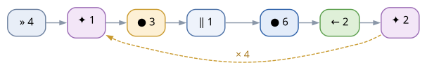

<div class="cover">
<p class="big">Пульт Apitor</p>
<p class="sub">Большая инструкция для юных пилотов</p>
<p class="who">роботы Robot R · J · S · Q · X · Wheels</p>
<p class="who">для детей 6–15 лет и их взрослых</p>

<p class="ver">исходник: docs/instructions-ru.md · английская версия: instructions-en.pdf</p>
</div>

# Содержание

1. Что такое пульт — {{page:1}}
2. Знакомство с роботом — {{page:2}}
3. Первое подключение — {{page:3}}
4. Как ехать — {{page:4}}
5. Подсветка — {{page:5}}
6. Три режима пульта — {{page:6}}
7. Первая программа — {{page:7}}
8. Программа «Квадрат» — {{page:8}}
9. Программа «Светлячок» — {{page:9}}
10. Испытания — {{page:10}}
11. Файлы программ и редактор — {{page:11}}
12. Макрос и обратный проезд — {{page:12}}
13. Если что-то не так — {{page:13}}
14. Взрослым: установка, флаги, подстройка — {{page:14}}
15. Словарик — {{page:15}}
16. Шпаргалка — {{page:16}}

**Как читать эту инструкцию.** Клавиши набираются на клавиатуре,
поэтому они всегда в рамочке: `q`, `w`, `Shift+Q`. Программы можно
записывать словами — вот так:

```
повтор 4
вперёд 4
вправо 2
```

Жёлтая врезка — подсказка, красная — «осторожно», зелёная —
испытание: попробуй сам. Номера вроде «раздел 5, стр. {{page:5}}» —
это ссылки на другие страницы. Звёздочки ★ у заданий — сложность:
★ просто, ★★ надо подумать, ★★★ для мастеров.

**С чего начать:**

| Если хочешь… | Открой |
|---|---|
| просто поездить | разделы 3–5 |
| научить робота программе | разделы 6–8 |
| устроить представление со светом | разделы 9 и 10 |
| вернуть робота по следам | раздел 12 |
| починить, если что-то не так | раздел 13 |
| запустить и настроить пульт (взрослым) | раздел 14 |

# 1. Что такое пульт

«Пульт» — это программа на компьютере. Она по Bluetooth говорит роботу
Apitor, что делать. Ты нажимаешь клавиши — робот едет, крутится
и мигает светом.

Что понадобится:

* **робот Apitor** — собранный, с заряженной батарейкой;
* **компьютер с Bluetooth** — ноутбук или настольный с Bluetooth-адаптером;
* **окно терминала**, в котором уже запущен пульт.

Когда всё готово, в окне видно примерно такое:

```
[info] пульт Apitor — Robot R (product 'r')
[hint] q — подключиться · Shift+Q — отключиться · w/a/s/d — ехать · …
```

Пульт ещё не подключён к роботу — это делается клавишей `q`
(раздел 3, стр. {{page:3}}).
Если строки с приглашением нет совсем, позови взрослого:
раздел 14, стр. {{page:14}}.

Что умеет пульт:

| Что | Как | Раздел |
|---|---|---|
| ехать вперёд-назад и разворачиваться | `w` `s` `a` `d`, стрелки | 4 |
| менять скорость, включать буст | `]` `[`, `Shift` | 4 |
| зажигать свет, мигать, гасить | `1`…`8`, `0`, `b` | 5 |
| крутить мотор 3 (аксессуар) | `v` `V` | 2 |
| ездить по программе из шагов | `p`, потом `Enter` | 6–8 |
| записать поездку и проехать её обратно | `m`, `r`, `t` | 12 |
| сохранять программы в файлы | `f`, `g`, `e` | 11 |

Чего пульт не умеет: он не управляет роботом издалека (нужны те же
несколько метров), не заменяет официальное приложение и не поднимает
робота по лестнице.

А ещё пульт показывает, что происходит: строки `[robot]`, `[prog]`,
`[run]` — это его дневник. По нему всегда видно, что робот делает
прямо сейчас:

```
[robot] подключён: Robot R (AA:BB:CC:DD:EE:FF)
[prog] ↑5 · →2 (2 шага · ~1.8 с · скор. 6)
[run] готово: 2 шага за 1.8 с (план 1.8 с)
```

Роботы бывают разные: `Robot R`, `J`, `S`, `Q`, `X` — машинки,
`Wheels` — колёсная база. Устройство у всех похожее: два
мотора-колеса, светодиод и третий мотор для аксессуаров, поэтому
пульт подходит любой модели.

<div class="mission">
**Испытание «Первый взгляд».** Открой пульт и найди на экране три
строки: `[robot]`, `[prog]` и `[run]`. Расскажи, что каждая значит.
Потом найди клавишу `h` — пульт сам расскажет про клавиши.
</div>

# 2. Знакомство с роботом

{width=92%}

* **Мотор 1 и мотор 2** — левое и правое колесо. Если колёса крутятся
  в разные стороны, робот разворачивается на месте.
* **Блок управления** — «мозг» робота и батарейка. Если робот молчит,
  скорее всего, батарейку пора зарядить.
* **Светодиод** — маленькая лампочка. Ей можно управлять с клавиатуры
  (раздел 5, стр. {{page:5}}).
* **Мотор 3** — для дополнительных механизмов, если они есть у твоей
  модели. Клавиша `v` включает его вперёд, `V` — назад (это
  выключатель: нажал — включился, нажал ещё раз — выключился).

Вот те же части одной табличкой:

| Часть робота | Что это | Клавиши |
|---|---|---|
| Мотор 1 и мотор 2 | левое и правое колесо | `w` `s` `a` `d` |
| Светодиод | лампа спереди, видно издалека | `1`…`8`, `0`, `b` |
| Мотор 3 | ось для аксессуаров (если есть) | `v` `V` |
| Блок управления | «мозг» и батарейка | — |

Робот ездит «относительно себя»: куда смотрит его нос, туда и `w`.
Поставь робота носом от себя — и всё станет понятно.

<div class="mission">
**Испытание «Экзамен по роботу».** Покажи пальцем, где мотор 1,
мотор 2, мотор 3, светодиод и блок управления. Вспомни, какая
клавиша что включает.
</div>

# 3. Первое подключение

1. Включи робота.
2. Поставь его на пол — подальше от края стола, ног и хвостов.
3. Нажми `q`. Пульт начнёт искать робота.
4. Подожди несколько секунд — появится что-то такое:

```
[robot] ищу робота (включён и не занят телефоном?)...
[robot] нашёл Robot R (AA:BB:CC:DD:EE:FF), подключаюсь...
[ok] подключено: Robot R (AA:BB:CC:DD:EE:FF)
```

5. Готово! Теперь клавиши управляют роботом.

<div class="warn">
Если робот подключён к телефону, компьютер его не найдёт: Bluetooth
разговаривает только с одним устройством за раз. Закрой приложение
на телефоне и нажми `q` снова.
</div>

<div class="tip">
В следующий раз `q` подключится почти сразу: адрес робота запоминается.
Если робот выключен, пульт поищет заново и скажет об этом.
</div>

| Если что-то не так | Что делать |
|---|---|
| Ищет робота и не находит | робот включён? батарейка заряжена? |
| Робота занял телефон | закрой приложение на телефоне и нажми `q` снова |
| Нашёлся не тот робот | `Shift+Q` и запусти с `--product` (раздел 14) |
| Подключился, но не едет | нажми `w` в окне пульта — и проверь `]` (скорость) |
| Робот гудит на месте | уменьши скорость: `[` |
| Хочу проверить, кто подключён | первая строка окна: `[robot] подключён: …` |

Отключиться — `Shift+Q`. Это удобно, когда игра закончена: робот
остановится и перестанет ждать команд.

<div class="mission">
**Испытание «Сам подключусь».** Включи робота и подключись к нему
клавишей `q` без помощи взрослых. Потом отключись (`Shift+Q`)
и подключись снова: во второй раз получается быстрее, ведь адрес
робота уже запомнился.
</div>

**Почему во второй раз быстрее.** Адрес робота пульт запоминает
в файле `addresses.json` (раздел 14, стр. {{page:14}}), поэтому
`q` подключается сразу, без поиска. Если робот не отвечает,
пульт сам начнёт искать заново и обновит адрес.

Если роботов несколько (или рядом играет друг с таким же), скажи
пульту, какая модель нужна: `--product r`, `--product j` —
и так далее, до `--product w`. А `--no-cache` заставляет искать
заново каждый раз.

**Сколько ждать?** Обычно две-три секунды. Если прошло больше
пятнадцати, а робота всё нет — нажми `q` ещё раз: пульт начнёт
искать заново. Батарейка садится медленно, но перед долгой игрой
лучше поставить робота на зарядку.

# 4. Как ехать

{width=48%}

| Клавиши | Что делает |
|---|---|
| `w` или `↑` | вперёд |
| `s` или `↓` | назад |
| `a` или `←` | развернуться влево на месте |
| `d` или `→` | развернуться вправо на месте |
| `пробел` или `Esc` | СТОП — робот замирает мгновенно |
| `]` `[` или `+` `-` | скорость: 1 (очень медленно) … 12 (быстро) |
| `Shift` (держать) | буст: скорость 12, а после отпускания — прежняя |
| `j` или `k` | как ехать: «удержание» или «круиз-контроль» |

Как ехать — два способа, переключаются клавишами `j` и `k`:

* **удержание**: робот едет, пока клавиша нажата. Отпустил —
  остановился. Так удобнее всего учиться и парковаться.
* **круиз-контроль**: как в машине. Один раз нажал `w` — робот поехал
  и едет сам, руки свободны, а `пробел` — тормоз: нажал, и робот встал.
  Удобно для длинных прямых и для программ из одного шага.

<div class="tip">
Буст по `Shift` работает, только когда пульт «видит» нажатия клавиш
(на Linux это требует разрешения, см. раздел 14, стр. {{page:14}}). Если буст
не включается — просто езжай на обычной скорости. И помни: `Shift+Q` —
это отключение робота, а не буст.
</div>

<div class="mission">
**Испытание «Разминка».** Поставь робота в центр комнаты. Проедь
вперёд два счёта, остановись, вернись назад. Потом развернись на
четверть круга (`a` или `d`). Получилось — ты готов к разделу 7,
стр. {{page:7}}.
</div>

# 5. Подсветка

{width=100%}

| Клавиша | Цвет | Клавиша | Цвет |
|---|---|---|---|
| `1` | красный | `5` | голубой |
| `2` | оранжевый | `6` | синий |
| `3` | жёлтый | `7` | фиолетовый |
| `4` | зелёный | `8` | белый |

* `0` — выключить подсветку совсем.
* `b` или `B` — мигнуть: светодиод быстро вспыхивает текущим цветом.
  Цвет при этом не меняется.

Цвета можно записывать и в программе: `цвет 1` — красный,
`цвет 5` — голубой, `цвет 0` — выключить. В режиме программы
клавиша `c` листает цвета по кругу, а `c` и сразу цифра выбирает
точный: `c3` — жёлтый.

<div class="mission">
**Игра «Светофор».** Один игрок — светофор: жёлтый, красный, зелёный.
Второй — водитель: на красный стоит, на зелёный едет, на жёлтый
готовится. Потом поменяйтесь.
</div>

<div class="mission">
**Испытание «Гирлянда».** Набери в режиме программы: `цвет 1`,
`пробел`, `цвет 4`, `пробел`, `цвет 3`, `пробел` — и нажми `Enter`.
Робот постоит и перемигнёт тремя цветами, как гирлянда на ёлке.
</div>

Например, такая программа-светофор:

```
цвет 1
пауза 1
цвет 4
пауза 1
цвет 0
```

Робот постоит с красным, потом с зелёным, а потом погасит свет —
и его можно звать дальше. Цвет остаётся включённым, пока не
нажмёшь другой: как у настоящей машинки с мигалкой.

Где что нажимать — чтобы не путаться:

| Хочу | В пульте | В программе |
|---|---|---|
| зажечь цвет | цифры `1`…`8` | шаг `цвет 4` или `c4` |
| выключить свет | `0` | шаг `цвет 0` |
| мигнуть | `b` или `B` | шаг `мигнуть` (или `b`) |
| поменять цвет по кругу | — | клавиша `c` |

<div class="tip">
Мигание цвет не меняет: `b` вспыхивает тем, что горит сейчас.
А цифры в режиме программы не зажигают свет — они попадают
в шаг: `c3` — это «зажечь жёлтый», а не «зажечь сейчас».
</div>

# 6. Три режима пульта

{width=52%}

* **Пульт** — клавиши ведут робота (разделы 4 и 5, стр. {{page:4}}
  и {{page:5}}).
* **Программа** — ты набираешь шаги; робот стоит и ждёт.
* **Прогон** — робот выполняет программу сам.

Как переходить:

| Клавиши | Куда попадаешь |
|---|---|
| `p` или `P` | в режим программы — всегда и откуда угодно |
| `Enter` | запустить программу (начался прогон) |
| `Esc` | назад в пульт (программа остаётся в памяти) |
| `Enter` | выполнить программу (с `Shift` — без пауз) |
| `r` `t` | в пульте: проехать маршрут обратно (раздел 12, стр. {{page:12}}) |

Хитрость: если нажать `p`, когда робот едет, пульт остановит его
и откроет программу. А выйти из программы можно только через `Esc` —
нажатие `p` внутри программы ничего не делает. Случайно не выскочишь.

Во время прогона: `пробел` — пауза и продолжить, `Esc` — остановить
и вернуться в пульт, `p` — остановить и сразу перейти к правке программы.

Светодиод подсказывает состояние: зелёная вспышка — старт, две зелёные —
финиш, красная — программу прервали. После финиша возвращается цвет,
который был раньше.

# 7. Первая программа

Программа — это список шагов: поехать, повернуть, подождать, мигнуть,
поменять цвет. Набирается в режиме программы (`p`), а на один раз — `o`.

| Клавиши | Шаг программы |
|---|---|
| `w` `s` `a` `d` (или стрелки) | вперёд, назад, влево, вправо |
| цифры `1`…`9` `0` | сколько раз: `wwwww` = «вперёд 5», `w5` — тоже, `0` — десять |
| `пробел` | пауза |
| `b` | мигнуть |
| `c` | цвет по кругу; `c` и сразу цифра — точный цвет (`c3` — жёлтый) |
| `]` `[` | скорость программы (цифры сразу: `]12`) |
| `*` (звёздочка, `Shift`+`8`) | повтор всей программы: `*` — по кругу 1→2→…, `*5` — ровно 5 раз |
| `Backspace` | убрать последний шаг |
| `x` | очистить программу целиком |
| `Enter` | запустить |
| `Esc` | вернуться в пульт |

Клавиши `r` `R` `t` `T` в этом режиме тоже работают: робот проедет
маршрут обратно, а программа останется на месте (раздел 12).

Под окном пульт показывает программу значками:

```
[prog] ↑5 · →1 · ✦2 (3 шага · ~4.2 с · скор. 6)
```

Значки те же, что в файлах и на схемах:

| Значок | Шаг | Слово |
|---|---|---|
| `↑` | вперёд | `вперёд` или `forward` |
| `↓` | назад | `назад` или `back` |
| `←` `→` | влево, вправо | `влево` `вправо` или `left` `right` |
| `‖` | пауза | `пауза` или `pause` |
| `✦` | мигнуть | `мигнуть` или `blink` |
| `●` | цвет | `цвет 3` или `color 3` |

Число рядом со значком — сколько раз повторить шаг.

**Сколько это длится.** Один шаг «вперёд» — примерно 0,6 секунды
(число умножается на 0,6), поворот — столько же, пауза — 1 секунду,
одно мигание — 0,25 секунды. Пульт сразу показывает оценку `~4.2 с`,
а после прогона — сколько вышло на самом деле.

<div class="mission">
**Испытание «Тук-тук».** Программа: `вперёд 2`, `пауза 1`, `назад 2`.
Что получилось? А если паузу заменить миганием — робот успеет
«постучать» светом?
</div>

# 8. Программа «Квадрат»

{width=72%}

Квадрат — первая настоящая программа. Робот едет вперёд, поворачивает,
и так четыре раза — получается квадрат. Набери в режиме программы:

```
w4      вперёд 4
d2      повернуть вправо 2
b2      мигнуть 2
*4      повторить всё четыре раза
```

Нажми `Enter` — и робот поехал. Клавиша `*` (звёздочка) повторяет
всю программу, а цифра после неё говорит, сколько раз: `*4` —
четыре круга. То же самое можно записать словами в файле программы
(раздел 11, стр. {{page:11}}):

```
повтор 4
вперёд 4
вправо 2
мигнуть 2
```

<div class="tip">
Поворот на четверть круга — примерно `d2`. Если квадрат получился
кособокий, попробуй `d1` или `d3`: на разных покрытиях робот
поворачивается чуть по-разному. Это нормально — робот не зря
катается по ковру и по плитке.
</div>

<div class="mission">
**Испытание «Большой квадрат».** Сделай квадрат в два раза больше:
`вперёд 8`, `вправо 2`, `повтор 4`. Прикинь, сколько секунд будет
длиться прогон, и проверь себя по строке `[prog]`.
</div>

**Почему получается квадрат.** Поворот `вправо 2` — это примерно
четверть круга, 90°. Четыре поворота вместе — 360°, полный круг,
поэтому робот возвращается туда, откуда выехал. А если поставить
`вправо 1`, робот повернёт всего на полчетверти, и квадрат
превратится в кривой семиугольник. Математика!

<div class="mission">
**Испытание «Прямоугольник».** Сделай две стороны длинными,
а две короткими: `вперёд 8`, `вправо 2`, `вперёд 4`, `вправо 2`
и `*2` в конце. Объясни, почему хватило повторить два раза.
</div>

В строке `[prog]` видно длину программы: `(3 шага · ~4.2 с)`.
Значит, четыре круга займут секунд шестнадцать — как раз можно
успеть досчитать до шестнадцати и проверить робота.

# 9. Программа «Светлячок»

Теперь танец со светом: робот крутится, а подсветка меняет цвет.
Набери программу (или напиши в файле и загрузи клавишей `g`):

```
скорость 4
повтор 4
мигнуть 1
цвет 3
пауза 1
цвет 6
пауза 1
влево 2
мигнуть 2
```

Что происходит: робот мигает жёлтым, ждёт, вспыхивает синим, ждёт,
разворачивается влево и мигает ещё раз — и так четыре круга.
Получается маленький спектакль.

{width=100%}

| Шаг | Что делает робот |
|---|---|
| `скорость 4` | ехать помедленнее: танец выходит плавным |
| `повтор 4` | выполнить всю программу четыре раза |
| `мигнуть 1` | вспыхнуть текущим цветом |
| `цвет 3` | зажечь жёлтый |
| `пауза 1` | постоять секунду |
| `цвет 6` | зажечь синий |
| `влево 2` | развернуться на месте |
| `мигнуть 2` | мигнуть дважды |

<div class="mission">
**Испытание «Свой светлячок».** Поменяй цвета и паузы на свои
и сделай спектакль на четыре круга. Попробуй `скорость 8`,
а потом `скорость 2` — танец получится совсем разным.
</div>

<div class="tip">
Цвет — это тоже шаг: робот меняет подсветку не сразу, а когда
до этого шага доедет. Поэтому «танец» из цветов и пауз выглядит
как настоящий светомузыкальный номер.
</div>

# 10. Испытания

Задания со звёздочками: ★ — просто, ★★ — надо подумать,
★★★ — для мастеров.

1. ★ **Прямая.** Проедь от одного края ковра до другого и вернись.
2. ★ **Светофор.** Программа: красный, пауза, зелёный, мигнуть,
   поехать.
3. ★★ **Змейка.** Вперёд, поворот вправо, вперёд, поворот влево —
   и так три раза.
4. ★★ **Два квадрата.** Квадрат из раздела 8 (стр. {{page:8}}) с `повтор 2` — робот
   должен вернуться туда, откуда начал.
5. ★★ **Танец.** Крутиться, мигать и менять цвет так, чтобы взрослые
   угадали мелодию.
6. ★★★ **Гонка с бустом.** Длинная прямая на скорости 12 (буст
   `Shift`) — и не задеть мишень.
7. ★★★ **Лестница.** Вперёд, вправо, вперёд, вправо… Сделай из
   ступенек путь к игрушке. Сколько шагов до неё?

Подсказки (открывай, только если совсем застрял):

8. ★★ **Восьмёрка.** Два круга в разные стороны — знак бесконечности.
9. ★★ **Дозор.** Проедь по периметру комнаты и вернись на место
   клавишей `r`.
10. ★★★ **Повторитель.** Поезди по комнате, запиши поездку
    макросом (`m`, стоп — `Esc`) и верни робота домой клавишей `r`.

Подсказки (открывай, только если совсем застрял):

* Змейка: `w3 d1 w3 a1` — и повторить несколько раз.
* Два квадрата: поставь `повтор 2` в самом начале программы.
* Лестница: подбери число поворота так, чтобы получалась ровная
  четверть круга (начни с `d2`).
* Гонка: разгон лучше делать на прямой, а перед мишенью жать `пробел`.
* Восьмёрка: круг влево (`w2 a2`), круг вправо (`w2 d2`) — и повторить.
* Дозор: после разворота возвращайся тем же путём наоборот — или
  просто нажми `r`.

**Дневник испытаний.** Впиши, что получилось (и когда):

| № | Испытание | Получилось |
|---|---|---|
| 1 | Прямая | ☐ |
| 2 | Светофор | ☐ |
| 3 | Змейка | ☐ |
| 4 | Два квадрата | ☐ |
| 5 | Танец | ☐ |
| 6 | Гонка с бустом | ☐ |
| 7 | Лестница | ☐ |
| 8 | Восьмёрка | ☐ |
| 9 | Дозор | ☐ |
| 10 | Повторитель | ☐ |

# 11. Файлы программ и редактор

Программу можно сохранить в файл — и загрузить в следующий раз.

| Клавиши | Действие (в режиме программы) |
|---|---|
| `f` | сохранить: пульт спросит имя, `Enter` — согласиться |
| `g` | загрузить: список файлов, набери номер и `Enter` |
| `e` (`E`) | править программу в большом редакторе (можно и из пульта) |
| `x` | очистить программу |

Файлы программ лежат в папке `programs/` рядом с пультом. Их можно
открыть блокнотом и писать словами — по-русски или по-английски:

```
# квадрат: четыре стороны и мигнуть в конце
скорость 5
повтор 4
вперёд 4
вправо 2
мигнуть 2
```

Все слова, которые понимает пульт:

| Слово | Значок | Что значит |
|---|---|---|
| `вперёд`, `forward`, `up` | `↑` | ехать вперёд |
| `назад`, `back`, `down` | `↓` | ехать назад |
| `влево`, `left` | `←` | повернуть влево |
| `вправо`, `right`, `rght` | `→` | повернуть вправо |
| `пауза`, `pause` | `‖` | постоять |
| `мигнуть`, `blink` | `✦` | мигнуть |
| `цвет 3`, `color 3` | `●3` | сменить цвет |
| `повтор 4`, `repeat 4` | — | выполнить всё четыре раза |
| `скорость 5`, `speed 5` | `»5` | сменить скорость с этого места |
| `вперёд 1.2с`, `up 1.2s` | `↑1.2с` | ехать ровно 1.2 секунды |

После `#` можно писать что угодно — это комментарий, пульт его
не читает. Большие и маленькие буквы, `ё` и `е`, запятые и `×`
пульт прощает. Понимает он и русские, и английские слова сразу.

В разовую программу файл загружается так же: `o`, потом `g`.
Пульт скажет «загружено разово» и не тронет программу из `p`.

<div class="mission">
**Испытание «Туда и обратно по файлу».** Набери квадрат, сохрани
его клавишей `f` под именем `квадрат2.txt`, очисти (`x`) и загрузи
обратно клавишей `g`. А потом открой `e` и допиши в файле строку
`цвет 5` в самое начало.
</div>

<div class="tip">
Набранная программа не пропадёт, даже если закрыть пульт: он хранит
черновик и подхватывает его в следующий раз. А готовые примеры лежат
в папке `examples/`.
</div>

# 12. Макрос и обратный проезд

Программу можно не набирать руками, а **показать**: пусть пульт сам
запишет поездку. Такая запись называется **макрос**.

**Как записать:**

1. Нажми `m` — в логе появится `[rec] запись макроса`.
2. Управляй роботом как обычно: `w` `a` `s` `d`, свет, повороты,
   паузы. Пульт записывает всё, и каждая поездка становится шагом
   с секундами.
3. Нажми `Esc` (или `n`) — запись готова и уже стоит в строке программы.
   `m` только начинает запись: если нажать её ещё раз, пульт просто
   напомнит, что запись идёт.

```
[rec] запись макроса: езда, свет, скорость — всё запишется, паузы станут ожиданием; Esc или n — стоп
[rec] ↑
[rec] ←
[rec] макрос записан: 3 шага · 2.88 с — Enter — проехать, r/t — обратно, f — сохранить, p — править
```

Теперь `Enter` — и робот сам повторит поездку: с паузами, светом
и скоростью, как было. Макрос — обычная программа: его можно править
(`p`), сохранить файлом (`f`) и загрузить в следующий раз (`g`).

<div class="warn">
Пока идёт запись, `p`, `Enter`, `r`, `t`, `x`, `f`, `g` не работают:
сначала закончи запись — `Esc` или `n`. А `пробел` — просто стоп робота,
запись при этом продолжается.
</div>

## Обратный проезд: `r` и `t`

Робот уехал в другой конец комнаты. Как вернуть его по своим следам,
не собирая вторую программу? Для этого есть две клавиши:

* `r` — **задним ходом**. Робот проезжает маршрут с конца, и всё
  зеркально: «вперёд» становится «назад», «влево» — «вправо».
  Он пятится по своим следам.
* `t` — **робота развернули рукой**. В конце маршрута ты повернул его
  на 180°, и он едет обратно передом: меняются только повороты
  (влево ↔ вправо).

{width=100%}

Длительность сохраняется: если туда робот ехал 2 секунды, обратно он
тоже поедет 2 секунды (числа вроде `↑5` превращаются в секунды).

**Скорость и цвет переключаются там, где ты их менял.** Едешь
сначала на 6, потом переключил на 12 и доехал до конца — обратно
робот начнёт сразу с 12 (ведь этот участок проехали на ней),
а на точке перелома снова включит 6 и так и поедет до конца.
С цветом то же самое: участок, проеханный голубым, и обратно
поёдется голубым, а цвет переключится ровно тогда, когда до
этого участка доедешь (на схеме видно: `●5` `●3` `●1` встали
по-другому). Участки, которые ехали «при том, что горело»,
получают свет, который горел до прогона.

<div class="tip">
`Shift+Enter` — проехать программу без пауз, а `R` или `T` (`Shift`
вместе с `r` или `t`) — так же обратно, без пауз. Заглавная буква
приходит сама, а `Shift+Enter` пульт узнаёт от самого терминала
(kitty, foot, alacritty и другие) — или от слежения за клавишами,
если оно включено (взрослый знает, что это: раздел 14, стр. {{page:14}}).

Обратный проезд работает и из режима программы: набери шаги, нажми
`r` (или `t`) — робот поедет, а программа останется на месте.
</div>

Обратный проезд не портит программу: он строится на лету, поэтому
после него `Enter` снова везёт вперёд, а `p` показывает прежние шаги.
И `повтор` тут ни при чём: обратно робот всегда едет один раз — после
первого проезда он уже стоит в начале маршрута и смотрит в другую
сторону.

<div class="mission">
**Испытание «Туда и обратно».** Проедь маршрут с двумя скоростями
и двумя цветами, запиши его макросом и вернись клавишей `r`.
Загляни в строки `[run]`: видно, что обратно робот начал
с последней скорости.
</div>

Все четыре клавиши рядом:

| Клавиши | Что делает робот |
|---|---|
| `r` | едет по маршруту назад, задним ходом |
| `t` | тоже назад, но передом — для развёрнутого рукой робота |
| `R` `T` | то же самое без пауз, одним движением |
| `пробел`, затем `r` / `t` | вернуть только по уже проеханному пути |

В окне пульта это видно по строкам `[run]`:

```
[run] старт: 9 шагов · скор. 6 · реверс задним ходом
[run] ▶ »12
[run] ▶ ↓0.6с
[run] ▶ ↓0.6с
[run] ▶ ↑0.6с
[run] ▶ »6
[run] ▶ ←0.6с
[run] готово: 9 шагов за 4.6 с
```

Скорость 12 стоит в самом начале не случайно: её поставили
как раз там, где она менялась в исходной программе.

Пока идёт запись, в окне видно такие строки:

```
[rec] запись макроса: езда, свет, скорость — всё запишется,
      паузы станут ожиданием; Esc или n — стоп
[rec] … делайте что-нибудь (Esc или n — стоп)
```

А когда запись остановишь — сколько шагов получилось:

```
[rec] макрос записан: 7 шагов · 5.4 с — Enter — проехать,
      r/t — обратно, f — сохранить, p — править
```

**Что попробовать с обратным проездом:**

* Буква «П»: вперёд, поворот, вперёд, разворот, вперёд — а
  обратно нажми `r`: робот сам проедет букву задом наперёд.
* Светофорная дорожка: поставь в файле `цвет 1` в начале
  и `цвет 5` в конце маршрута — обратно цвета встанут
  в другом порядке.
* Долгая поездка: в файле поставь `скорость 12` в середине —
  обратно робот поедет быстро, а к дому приедет медленно.
* Возврат на полпути: запусти «долгую поездку» и нажми `пробел`,
  когда робот проедет только часть пути, а потом `r` — домой он
  поедет коротким путём, только по проеханному.

## Робот поехал не туда: вернуть проеханное

Бывает, что робот поехал не туда. Ждать конца программы не нужно:
поставь прогон на паузу (`пробел`), а потом нажми `r` или `t` — робот
поедет обратно **только по той части маршрута, которую уже проехал**.
Это быстрый способ вернуть его на место.

Если пауза застала робота посреди длинного шага, назад он поедет ровно
столько секунд, сколько успел проехать. Программа «вперёд 20с», пауза
на 16-й секунде — обратный маршрут начнётся с «назад 16с», а дальше
пойдут уже проеханные шаги в обратном порядке. Всё остальное — как у
обычного обратного проезда: повороты зеркально, паузы и свет на своих
местах, а `R` и `T` — без пауз. Программа при этом не меняется: `Enter`
после возврата снова везёт её вперёд.

```
[run] пауза на шаге 1 из 1 — везу обратно по проеханному
[run] старт: 1 шаг · скор. 6 · реверс проеханной части (задним ходом)
[run] ▶ ↓16с
```

Без паузы `r` и `t` во время прогона не срабатывают: пульт подскажет
сначала нажать `пробел`.

<div class="tip">
Пауза ничего не портит: если нажать `пробел` ещё раз, робот спокойно
поедет дальше с того же места. А `r` или `t` заканчивают прогон и
начинают обратный путь. Так что на паузе есть выбор: доехать дальше
или вернуться.
</div>

Если программа повторялась, возврат пойдёт по всему проеханному пути:
и по первому кругу, и по той части второго, которую робот успел
проехать. Вернётся он туда, откуда начал программу, — туда же, куда
приводит и полный обратный проезд.

<div class="mission">
**Испытание «Стоп, не туда!».** Запусти длинную программу и нажми
`пробел`, когда робот проедет только часть пути. Потом `r` — и
посмотри в строках `[run]`, сколько секунд он поехал обратно: ровно
столько, сколько успел проехать.
</div>

Что попадёт в обратный маршрут:

| Что было | Что будет на пути назад |
|---|---|
| проеханное движение | зеркальное: `вперёд` ↔ `назад`, `влево` ↔ `вправо` (у `t` зеркалятся только повороты) |
| недоеханный длинный шаг | отрезок в секундах: сколько успел проехать |
| проеханная пауза | пауза, как и в полном возврате (у `R` и `T` — без пауз) |
| мигание | мигание |
| свет и скорость | включатся там, где ты их менял |

В журнал прогонов (`--log`) попадут обе строки: где прервался
и что вернулся.

**Остаток программы робот не поедет.** После возврата прогон
заканчивается: робот стоит там, откуда начал. Хочешь проехать
программу целиком — нажми `Enter`, и он поедет с самого начала
(шаги при этом не меняются).

Если это была разовая программа (`o`), после возврата она уже исчезла:
`Enter` и `r`/`t` снова работают с программой из `p`.

<div class="tip">
Возврат — обычный прогон: в строках `[run]` видно каждый его шаг,
а `пробел` на нём снова ставит на паузу. Свет после возврата — тот,
что горел до прогона.
</div>

# 13. Если что-то не так

| Что случилось | Что делать |
|---|---|
| `[err] подключиться не удалось` | робот включён? не занят телефоном? нажми `q` ещё раз |
| Робот едет назад вместо вперёд | это чинится настройкой: раздел 14 (стр. {{page:14}}), «калибровка» |
| Робот едет слишком медленно или быстро | `]` и `[` меняют скорость (1…12) |
| Клавиши не действуют | пульт слушает клавиатуру только когда его окно активно? Нажми `h` — увидишь подсказку. В других окнах не печатай `w a s d` |
| `Enter` не запускает программу | посмотри на строку `[prog]`: если там `0 шагов`, программа пустая |
| Робот остановился посреди программы | нажался `пробел` (пауза) — нажми ещё раз |
| Робот поехал не туда | `пробел`, потом `r` (или `t`) — робот вернётся только по уже проеханному пути |
| Всё зависло | `Ctrl+C`: пульт остановит моторы и выйдет |
| Не понятно, что нажимать | `h` — справка; `Esc` — назад в пульт |
| `[err] программа не изменилась` | в файле опечатка: открой `e` и посмотри |
| Файла нет в списке `g` | проверь папку `programs/` (раздел 14, стр. {{page:14}}) |
| Робот мигает и не едет | нажался `пробел` — нажми ещё раз |
| После программы свет другой | так и задумано: после финиша возвращается прежний цвет |
| Программа выполнилась не так | нажми `p` и посмотри шаги; `x` — очистить |
| Робот заехал под шкаф | `Esc` — стоп; потом достань его руками или `q` — переподключись |
| Программа длится очень долго | проверь `повтор`: число в начале программы |
| Свет мигает сам по себе | это мигание из программы (`✦`), дождись `Esc` |

**Первая помощь по шагам.** Если робот ведёт себя странно:

1. Нажми `Esc` — пульт остановит робота. Это безопасно в любой момент.
2. Посмотри последнюю строку в окне: там написано, что случилось.
3. Нажми `h` — подсказка, `q` — подключиться заново. Журнал прогонов
   включается флагом `--log` (раздел 14).
4. Если совсем ничего не помогает: `Ctrl+C` и запусти пульт заново.

**Если робот уехал далеко.** Нажми `Esc` — пульт остановит его
мгновенно, где бы он ни был. Дальше три способа вернуть робота
домой: доехать самому (просто `w` в нужную сторону), нажать `r`
(робот вернётся по следам) или `t`, если ты успел развернуть
его рукой. А если робот совсем уехал за пределы комнаты — `q`
для переподключения и `y` для проверки моторов.

<div class="tip">
Почти всё лечится тремя вещами: `Esc`, `q` и `Ctrl+C`. Их можно
нажимать смело — робот ничего не сломает, а пульт всегда
остановит моторы перед выходом.
</div>

# 14. Взрослым: установка, флаги, подстройка

**Самый простой запуск:** двойной щелчок по `run.sh` (Linux) или
`run.bat` (Windows). Файл сам создаст `.venv`, поставит зависимость,
откроет терминал и запустит пульт. Пульт сразу открывается на весь
экран, а `--no-tui` возвращает обычный построчный вывод. Флаги
передаются как есть:
`run.sh --no-tui` или `run.bat --program examples/square.txt`.

**Установка руками** (один раз):

```bash
cd Apitor-WASD
python3 -m venv .venv
.venv/bin/pip install -r requirements.txt
```

**Запуск:**

```bash
./run.sh                                         # то же самое одной командой
.venv/bin/python apitor_remote.py                # полноэкранный пульт (по умолчанию)
.venv/bin/python apitor_remote.py --no-tui       # обычный построчный вывод
.venv/bin/python apitor_remote.py --simulate     # без робота: печатать кадры
.venv/bin/python apitor_remote.py --program examples/квадрат.txt
```

На Linux пульту нужно разрешение читать клавиатуру (иначе он
предупредит и включит авто-стоп): `sudo usermod -aG input "$USER"`,
затем выйти из системы и войти снова. На Windows достаточно Python
3.10+ и Bluetooth.

Буст (зажать `Shift` — скорость 12) работает только при включённом
слежении за клавишами. `Shift+Enter` и заглавные `R`, `T` — сами по
себе: при старте пульт спрашивает терминал, умеет ли тот различать
`Shift` (kitty-протокол: kitty, foot, alacritty, wezterm, ghostty,
свежий GNOME Terminal), и включает расширенные клавиши, если умеет.
Если слежение не нужно совсем (хватает авто-стопа по `--hold-timeout`),
запускайте с `--no-key-state`: пульт не будет читать клавиатуру из
`/dev/input` и предупреждать об этом.

Полезные флаги (все — в README):

| Флаг | Зачем |
|---|---|
| `--speed 6` | начальная скорость 1…12 |
| `--product r` | модель робота: `r`, `j`, `s`, `q`, `x`, `w` |
| `--no-tui` | обычный построчный вывод (полноэкранный — по умолчанию; прежний `--tui` принимается) |
| `--no-cache` | не пользоваться сохранённым адресом робота |
| `--simulate` | без робота: печатать кадры, которые ушли бы ему |
| `--cruise` | стартовать с включённым круиз-контролем (прежнее имя — `--latched`) |
| `--program-dir ПАПКА` | где лежат файлы программ (по умолчанию `programs/`) |
| `--step-time` `--turn-time` `--pause-time` `--blink-time` | длительность шагов, с (0.6 / 0.6 / 1.0 / 0.25) |
| `--max-steps N` | ограничить длину программы (0 — без лимита) |
| `--log` | журнал прогонов в `~/.config/apitor-control/runs.log` |
| `--key-state-device ПУТЬ` | слушать только одну клавиатуру |
| `--no-key-state` | вообще не читать клавиатуру: без разрешений и предупреждений |
| `--verbose` | подробный вывод: кадры протокола и сканирование |
| `--lang en` | английский интерфейс |

**Калибровка** (если робот едет не туда). Подключитесь и нажмите `y`:
робот поедет вперёд, назад и в стороны — будет видно, что перепутано.
Дальше запускайте с нужным флагом:

```bash
.venv/bin/python apitor_remote.py --flip-left     # левое колесо крутится не туда
.venv/bin/python apitor_remote.py --flip-right    # правое колесо
.venv/bin/python apitor_remote.py --left-motor 2 --right-motor 1   # колёса перепутаны
```

Клавиша `i` включает моторы по одному — так видно, какой порт что
крутит.

**Эта инструкция.** Исходники: `docs/instructions-ru.md`,
`docs/instructions-en.md`, схемы — `docs/diagrams/*.dot`. Чтобы
пересобрать картинки, HTML и PDF:

```bash
docs/build.sh
```

Нужны `pandoc`, `graphviz`, `calibre` и `pdftotext` (poppler) —
подробности в `docs/README.md`.

Проверка без робота (полезно сразу после установки):

```bash
.venv/bin/python apitor_remote.py --simulate
```

Пульт будет печатать кадры, которые отправил бы роботу, — видно,
что произойдёт, а робот при этом не нужен.

**ЧАВО.**

| Вопрос | Ответ |
|---|---|
| Робот не находится | включён? заряжен? не занят ли телефоном? Bluetooth на месте? |
| Пульт предупреждает про клавиатуру | добавьте пользователя в группу `input` или запускайте с `--no-key-state` |
| Не нужны остановки по таймеру | включите слежение за клавишами (группа `input`) или уменьшите `--hold-timeout` |
| Где журнал прогонов | `~/.config/apitor-control/runs.log` (флаг `--log`) |
| Как всё вернуть к исходному | удалите файлы из `~/.config/apitor-control/` — пульт создаст их заново |
| Нужен запуск без терминала | двойной щелчок по `run.sh` / `run.bat` |
| Где взять примеры программ | папка `examples/`, например `examples/квадрат.txt` |

Вся настройка живёт в папке `~/.config/apitor-control/`:

| Файл | Что внутри |
|---|---|
| `addresses.json` | адреса роботов: чтобы `q` подключался сразу |
| `config.json` | язык, длительности шагов, папка программ, журнал |
| `runs.log` | журнал прогонов (включается флагом `--log`) |

Удалить эти файлы — самый простой способ «сбросить» пульт к
заводским настройкам: при следующем запуске он создаст их заново.

# 15. Словарик

* **Пульт** — программа, которая управляет роботом с клавиатуры (раздел 1, стр. {{page:1}}).
* **Макрос** — запись твоей поездки (`m`), из которой получается программа (раздел 12, стр. {{page:12}}).
* **Обратный проезд** — робот едет тот же маршрут с конца (`r`, `t`, раздел 12, стр. {{page:12}}).
* **Шаг** — одно действие программы: проехать, повернуть, мигнуть (раздел 7, стр. {{page:7}}).
* **Программа** — список шагов, который робот выполняет сам (раздел 7, стр. {{page:7}}).
* **Разовая программа** — набранная по `o`: не сохраняется, живёт до первого прогона и исчезает после него (раздел 7, стр. {{page:7}}).
* **Прогон** — выполнение программы от начала до конца (раздел 6, стр. {{page:6}}).
* **Повтор** — сколько раз выполнить всю программу (`*` или `повтор`, раздел 8, стр. {{page:8}}).
* **Удержание** — режим, где робот едет, пока держишь клавишу (раздел 4, стр. {{page:4}}).
* **Фиксация** — режим, где робот едет, пока не нажмёшь `пробел` (раздел 4, стр. {{page:4}}).
* **Буст** — ускорение до 12, пока держишь `Shift` (раздел 14, стр. {{page:14}}).
* **Черновик** — программа, которую пульт помнит между запусками (раздел 11, стр. {{page:11}}).
* **Терминал** — окно, в котором живёт пульт; клавиши нажимаются в нём (раздел 1, стр. {{page:1}}).
* **Скорость** — число от 1 (очень медленно) до 12 (быстро); меняется `]` и `[` (раздел 4, стр. {{page:4}}).
* **Подсветка** — светодиод робота; цвета `1`…`8`, а `0` — выключить (раздел 5, стр. {{page:5}}).
* **Мотор 3** — третья ось для аксессуаров; включается `v`, выключается `V` (раздел 2, стр. {{page:2}}).
* **Значок** — короткая запись шага: `↑5`, `‖`, `✦2`, `●3` (раздел 7, стр. {{page:7}}).
* **Файл программы** — текстовый файл с шагами в папке `programs/` (раздел 11, стр. {{page:11}}).
* **Комментарий** — пояснение после `#`; пульт его не читает (раздел 11, стр. {{page:11}}).
* **Секунда** — можно написать числом с буквой: `1.2с` вместо «сколько-то шагов» (раздел 7, стр. {{page:7}}).
* **Испытание** — задание со звёздочками ★; всего их десять (раздел 10, стр. {{page:10}}).
* **Реверс** — обратный проезд: тот же маршрут с конца (раздел 12, стр. {{page:12}}).
* **Запись** — макрос пишется, пока не нажмёшь `Esc` или `n` (раздел 12, стр. {{page:12}}).
* **Редактор** — режим программы, где шаги набирают клавишами (раздел 7, стр. {{page:7}}).
* **Пауза** — шаг, на котором робот стоит и ничего не делает (раздел 7, стр. {{page:7}}).
* **Кэш** — сохранённый адрес робота: поэтому `q` находит его сразу (раздел 3, стр. {{page:3}}).
* **Кадр** — команда, которую пульт отправляет роботу по Bluetooth (раздел 14, стр. {{page:14}}).
* **Модель** — какой это робот: R, J, S, Q, X или Wheels (раздел 1, стр. {{page:1}}).
* **Журнал** — записи о прогонах; включается флагом `--log` (раздел 14, стр. {{page:14}}).
* **Квадрат** — первая настоящая программа: четыре поворота (раздел 8, стр. {{page:8}}).
* **Светлячок** — программа-танец: повороты и цветные вспышки (раздел 9, стр. {{page:9}}).
* **Лексикон** — все слова, которые понимает файл программы (раздел 11, стр. {{page:11}}).
* **Флаг** — слово после имени программы в командной строке: `--no-tui`, `--simulate` (раздел 14, стр. {{page:14}}).
* **Симуляция** — режим без робота: пульт печатает кадры, но никого не ищет (раздел 14, стр. {{page:14}}).
* **Адрес робота** — его «имя» в Bluetooth; пульт помнит адрес, поэтому `q` срабатывает быстро (раздел 3, стр. {{page:3}}).
* **СТОП** — `пробел` или `Esc`: робот замирает и больше не едет (раздел 4, стр. {{page:4}}).
* **Мигнуть** — коротко вспыхнуть светом (клавиша `b`; раздел 5, стр. {{page:5}}).
* **Схема** — картинка в этой инструкции; исходники схем — в `docs/diagrams/` (раздел 14, стр. {{page:14}}).
* **Круиз-контроль** — режим, в котором робот едет сам, пока не нажмёшь `пробел` (раздел 4, стр. {{page:4}}).

# 16. Шпаргалка

**Пульт:**

| Клавиши | Что делают |
|---|---|
| `q` / `Shift+Q` | подключиться / отключиться |
| `w` `s` `a` `d`, стрелки | ехать (вперёд, назад, влево, вправо) |
| `пробел` `Esc` | СТОП |
| `]` `[` `+` `-` | скорость больше / меньше |
| `Shift` | буст (пока держишь) |
| `1`…`8`, `0` | цвет подсветки, `0` — выключить |
| `b` `B` | мигнуть |
| `v` `V` | мотор 3: вперёд / назад (тумблер) |
| `p` `P` | режим программы |
| `o` | разовая программа: не сохраняется, исчезает после прогона |
| `Enter` | выполнить программу: последний макрос или файл |
| `Shift+Enter` | то же, но без пауз |
| `r` `t` | проехать маршрут обратно: задним ходом / развернув робота |
| `R` `T` | то же, но без пауз |
| `m` | записать макрос (стоп — `Esc` или `n`) |
| `f` `g` | сохранить / загрузить файл программы |
| `e` `E` | редактор программы (работает и в пульте) |
| `y` `i` | тест-поездка / моторы по одному |
| `j` `k` | удержание / круиз-контроль |
| `h` `?` | справка |
| `Ctrl+C` | выход |

**Режим программы:** `w/a/s/d` — шаги · цифры — сколько раз ·
`пробел` — пауза · `b` — мигнуть · `c` — цвет · `*` — повтор ·
`]` `[` — скорость · `Backspace` — убрать шаг · `x` — очистить ·
`Enter` — запустить (с `Shift` — без пауз) · `Esc` — в пульт.
**Обратный проезд:** `r` `t` — задним ходом / развернув робота,
`R` `T` — то же без пауз; работает и в пульте, и в редакторе.
На паузе прогона — только по уже проеханному пути.

**Прогон:** `пробел` — пауза/продолжить · `Esc` — стоп · `p` — править.
На паузе: `r` `t` — вернуть проеханное. После прогона: `Enter` — ещё раз,
`r` `t` — обратно.

Мини-пример (квадрат) в виде файла `programs/квадрат.txt`:

```
скорость 5
повтор 4
вперёд 4
вправо 2
мигнуть 2
```

**Одной строкой** (самое нужное):

```
q подключиться · w a s d ехать · пробел СТОП · ] [ скорость ·
1…8 цвет · b мигнуть · p программа · o разово · Enter пуск ·
r t обратно · m макрос · f g файл · e редактор · h справка · Ctrl+C выход
```

**Что писать в файле программы:** `вперёд 4` · `назад 2` ·
`влево 1` · `вправо 2` · `пауза 1` · `мигнуть 2` · `цвет 3` ·
`повтор 4` · `скорость 5` · `вперёд 1.5с`. Пульт понимает и
английские слова: `forward`, `back`, `left`, `right`, `pause`,
`blink`, `color 3`, `repeat 4`, `speed 5`. После `#` — комментарий.

**Если забыл клавишу.** Нажми `h` — пульт покажет справку.
В режиме программы `h` тоже работает: там своя подсказка.
А журнал прогонов (флаг `--log`) покажет, что робот делал и
сколько это занимало времени.

**Мини-программа на память** (квадрат со светом):

```
скорость 5
повтор 4
вперёд 4
вправо 2
мигнуть 2
```

Как её запустить: нажми `p`, набери шаги (или загрузи файл
клавишей `g`) и нажми `Enter`.

**Три полезных привычки:**

1. Перед запуском смотри на `[prog]`: сколько шагов и какая скорость.
2. После прогона смотри строку `[run]`: в ней видно, сколько он занял времени.
3. Ставь робота носом от себя: тогда `w` — точно «вперёд».

**Куда дальше.** В папке `examples/` лежат готовые программы
(квадрат, светлячок и другие) — открой `g` и выбери. А ещё можно
устроить гонку с другом: расставь кегли и проедь трассу, не
сбив ни одной. Кто быстрее — тот и командир робота!

**Три клавиши-спасателя:**

| Клавиша | Когда выручает |
|---|---|
| `Esc` | робот делает что-то не то — мгновенный СТОП |
| `q` | связь потерялась — подключиться заново |
| `Ctrl+C` | пульт завис — остановить моторы и выйти |

**Проверка пилота:**

| Умею | ☐ |
|---|---|
| подключиться и отключиться (`q`, `Shift+Q`) | ☐ |
| ехать и поворачивать, менять скорость | ☐ |
| зажечь любой цвет и мигнуть | ☐ |
| набрать программу и запустить её | ☐ |
| записать макрос и вернуться клавишей `r` | ☐ |
| сохранить программу и загрузить её | ☐ |
| показать пульт другу | ☐ |

<div class="tip">
Больше программ и примеров — в папке `examples/`. Пилот, у которого
всё получилось: собери своего робота, поставь бутылку-мишень
и попробуй объехать её, не задев. Удачи!
</div>
